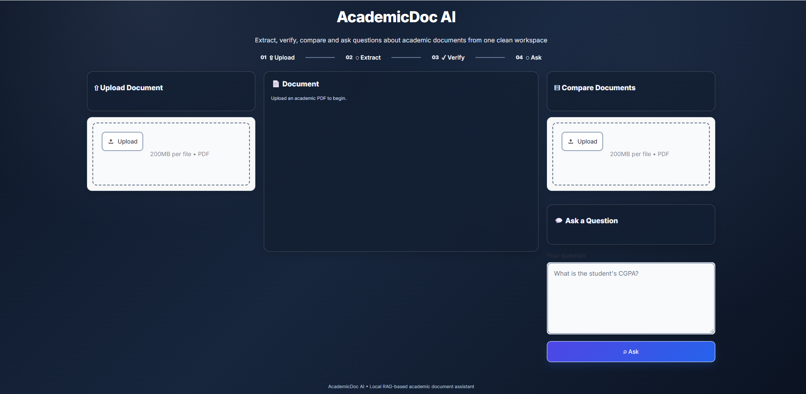
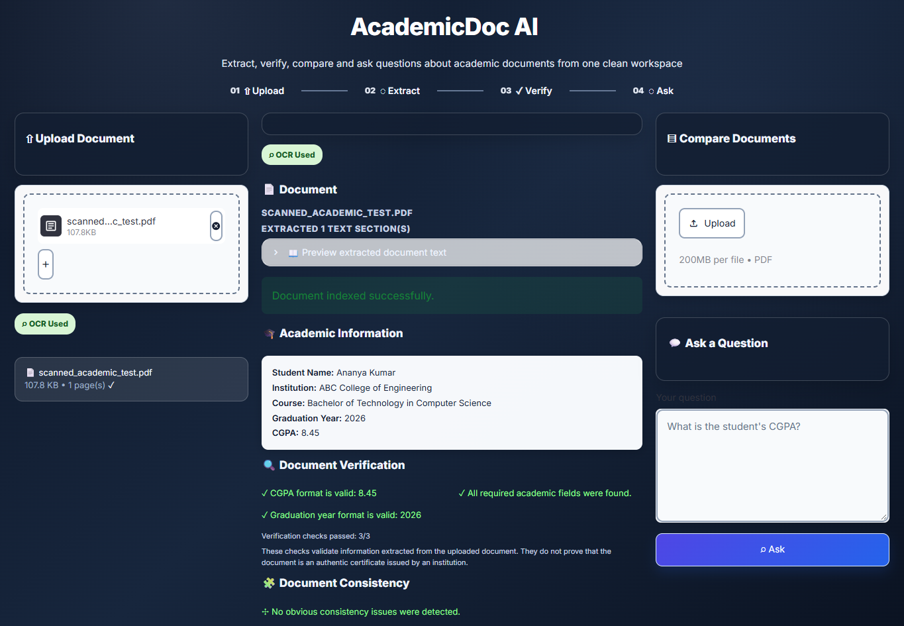
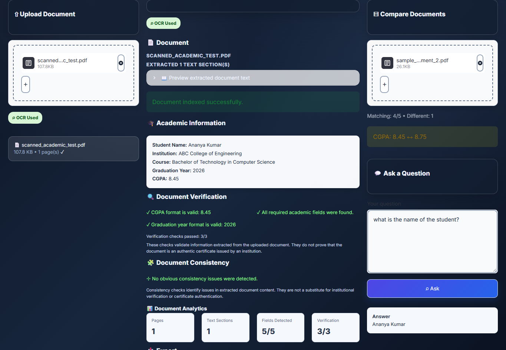
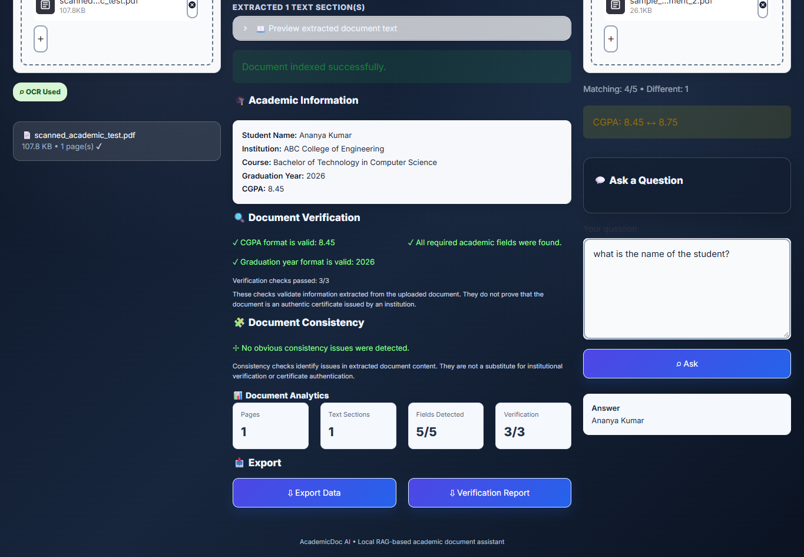

 

# AcademicDoc-AI – Academic Document Information Extraction and Validation System

AcademicDoc-AI is a Python-based academic document processing application designed to extract, validate, compare, and retrieve information from academic PDF documents. It combines PDF text extraction, Optical Character Recognition (OCR), rule-based information extraction, validation checks, document comparison, analytics, and retrieval-based question answering in a Streamlit interface.

The project also includes a separate semantic vector-search module using Sentence Transformers and FAISS to explore embedding-based document retrieval.

## Key Features

### 1. PDF Upload and Document Processing
- Upload academic PDF documents through the Streamlit interface.
- Supports digital and scanned PDF documents.
- Extracts text page by page using PyMuPDF.
- Automatically applies OCR when a page contains insufficient extractable text.
- Cleans extracted text before processing.

### 2. OCR and Academic Information Extraction
- Uses Tesseract OCR for scanned PDF pages.
- Extracts five academic information fields:
  - Student Name
  - Institution
  - Course
  - Graduation Year
  - CGPA
- Uses regular expressions and predefined text patterns to identify academic information.
- Supports common degree names and labelled academic fields.

### 3. Academic Information Validation
- Checks whether required academic fields are present.
- Validates CGPA numeric format and the expected 0–10 range.
- Checks graduation year format and expected year range.
- Displays verification results with pass and fail indicators.

### 4. Document Consistency Checking
- Identifies missing academic information.
- Detects invalid or unexpected CGPA values.
- Identifies unusual graduation year values.
- Displays detected consistency issues for review.

### 5. Document Analytics
- Displays the number of document pages and extracted text sections.
- Shows the number of academic fields detected.
- Displays document verification results.
- Provides a preview of extracted document text.

### 6. Document Comparison
- Allows users to upload a second academic PDF.
- Extracts the same five academic fields from both documents.
- Compares extracted values field by field.
- Displays matching fields and differences between documents.

### 7. Document Question Answering
- Allows users to ask questions about uploaded academic documents.
- Provides direct field-based answers for student name, institution, course, graduation year, and CGPA.
- Uses TF-IDF vectorization and cosine similarity to retrieve relevant document pages for other questions.
- Displays relevant retrieved passages and page references.
- Returns extracted document content rather than generating answers using an LLM.

### 8. Report Generation and Data Export
- Exports extracted academic information as a TXT file.
- Generates a PDF verification report using ReportLab.
- Includes extracted academic fields, verification results, and consistency-check information in the PDF report.

### 9. Separate Semantic Vector-Search Module
The project includes a standalone semantic-search implementation in `vector_store.py`.

- Uses Sentence Transformers with the `all-MiniLM-L6-v2` model.
- Generates numerical embeddings from text chunks.
- Uses FAISS for vector indexing.
- Implements similarity-based retrieval using an L2 distance index.
- Retrieves the most relevant text chunks for a given query.

**Note:** The FAISS semantic-search module is implemented separately and is not currently connected to the main Streamlit application.

## Technologies Used

| Category | Technologies |
|---|---|
| Programming Language | Python |
| Web Interface | Streamlit |
| PDF Processing | PyMuPDF |
| OCR | Tesseract OCR, Pytesseract |
| Image Processing | Pillow |
| Information Extraction | Regular Expressions |
| Text Retrieval | Scikit-learn, TF-IDF |
| Similarity Measurement | Cosine Similarity |
| Semantic Embeddings | Sentence Transformers |
| Vector Search | FAISS |
| Numerical Processing | NumPy |
| PDF Report Generation | ReportLab |
| Version Control | Git and GitHub |

## Project Architecture

The main application follows this processing workflow:

```text
              Academic PDF Upload
                      |
                      v
              PDF Text Extraction
                  (PyMuPDF)
                      |
                      v
             Check Extracted Text
                      |
             +--------+--------+
             |                 |
        Sufficient Text    Insufficient Text
             |                 |
             |                 v
             |              Tesseract
             |                 OCR
             |                 |
             +--------+--------+
                      |
                      v
               Text Cleaning
                      |
                      v
          Academic Information Extraction
                (Regular Expressions)
                      |
                      v
             Extract Five Fields
                      |
                      v
            Verification and Validation
                      |
                      v
             Consistency Checking
                      |
          +-----------+------------+
          |           |            |
          v           v            v
       Analytics  Document QA   Comparison
                      |
                TF-IDF Retrieval
                      |
              Cosine Similarity
                      |
                      v
              Relevant Text Pages
                      |
                      v
              Answer Presentation
                      |
                      v
               Export Results
                TXT / PDF
```

**Separate semantic-search module:**

```text
             Text Chunks
                  |
                  v
         Sentence Transformers
                  |
                  v
           Text Embeddings
                  |
                  v
             FAISS Index
                  |
                  v
           Query Embedding
                  |
                  v
          Similarity Search
                  |
                  v
        Relevant Text Chunks
```

The semantic-search workflow is implemented in `vector_store.py` independently of the main application.

## Project Structure

```text
AcademicDoc-AI/
│
├── app.py
│
├── vector_store.py
│
├── test.py
│
├── requirements.txt
│
├── .gitignore
│
├── Screenshots/
│   ├── upload.png
│   ├── ocr-extraction.png
│   ├── comparison-qa.png
│   └── results.png
│
└── data/
    ├── sample_academic_document.pdf
    ├── sample_academic_document_2.pdf
    └── scanned_academic_test.pdf
```

### Important Files

- **app.py:** Main Streamlit application containing PDF extraction, OCR, academic information extraction, validation, comparison, question answering, analytics, and export functionality.
- **vector_store.py:** Separate semantic embedding generation and FAISS similarity-search module.
- **test.py:** Small Streamlit UI styling experiment.
- **requirements.txt:** Python package dependencies.
- **Screenshots/:** Application screenshots.
- **data/:** Sample academic PDF documents.

## Application Screenshots

### 1. Upload and Document Workspace



### 2. OCR and Academic Information Extraction



### 3. Document Comparison and Question Answering



### 4. Validation, Analytics and Export



## Installation and Setup

### Prerequisites

- Python installed on your system.
- Tesseract OCR installed separately.
- Git installed on your system.

### Step 1: Clone the Repository

```bash
git clone https://github.com/archasunil1111-jpg/AcademicDoc-AI.git
```

### Step 2: Navigate to the Project Directory

```bash
cd AcademicDoc-AI
```

### Step 3: Create a Virtual Environment

**Windows:**

```bash
python -m venv venv
venv\Scripts\activate
```

**Linux / macOS:**

```bash
python3 -m venv venv
source venv/bin/activate
```

### Step 4: Install Dependencies

```bash
pip install -r requirements.txt
```

### Step 5: Configure Tesseract OCR

Install Tesseract OCR on your computer.

The current application uses the following Windows installation path in `app.py`:

```python
TESSERACT_PATH = r"C:\Program Files\Tesseract-OCR\tesseract.exe"
```

Update this path if Tesseract is installed in a different location or if you are using another operating system.

### Step 6: Run the Application

```bash
streamlit run app.py
```

The Streamlit application will open in your default browser.

## How to Use the Application

1. Launch AcademicDoc-AI.
2. Upload an academic PDF document.
3. Allow the application to extract text using PyMuPDF or OCR when required.
4. Review the extracted academic information.
5. Examine field validation and consistency-check results.
6. View document analytics and extracted text.
7. Upload a second PDF to compare academic information.
8. Enter a question about the uploaded document.
9. Review the retrieved answer and relevant source passages.
10. Export extracted data as TXT or download the verification report as PDF.

## Validation Rules

The application performs the following checks:

| Field | Validation |
|---|---|
| Student Name | Checks whether the field is extracted |
| Institution | Checks whether the field is extracted |
| Course | Checks whether the field is extracted |
| Graduation Year | Checks numeric format and expected year range |
| CGPA | Checks numeric format and expected 0–10 range |

The application displays three overall verification checks:

1. CGPA validation.
2. Graduation year validation.
3. Required academic fields validation.

Additional consistency checks identify missing fields and unexpected values.

## Limitations

- Academic information extraction depends on predefined regular-expression patterns and document text structure.
- OCR accuracy may vary depending on scan quality and document readability.
- Validation checks identify missing or unexpected extracted information; they do not independently verify academic records.
- Document comparison operates on the extracted academic fields rather than performing a complete semantic comparison of the original PDFs.
- Question answering uses rule-based field lookup and TF-IDF/cosine-similarity retrieval. It does not use an LLM to generate answers.
- The Sentence Transformers and FAISS semantic-search module is separate and not yet integrated into the main Streamlit workflow.
- The validation process cannot establish whether a certificate is authentic or genuinely issued by an educational institution.

## Project Purpose

AcademicDoc-AI demonstrates how PDF processing, OCR, information extraction, rule-based validation, document comparison, and retrieval-based question answering can be combined into a single Python application.

The project also explores embedding-based semantic search through a separate Sentence Transformers and FAISS module.

It highlights the practical application of document processing, natural language processing techniques, information retrieval, and Python-based application development.

## Future Improvements

- Integrate the separate FAISS semantic-search module into the main application.
- Improve academic field extraction for different document layouts.
- Expand OCR support for different scanned document formats.
- Improve question-answering capabilities and retrieval accuracy.
- Explore optional LLM-based question answering with clear source references.

## Important Disclaimer

AcademicDoc-AI performs automated information extraction and rule-based consistency checks on uploaded academic documents. Its results are intended to assist document review. They do not establish the authenticity of a certificate, verify information against institutional databases, or replace official academic verification.

## Author

**Archa Sunil**

AI/ML Graduate | Python | Machine Learning | Generative AI

- GitHub: [archasunil1111-jpg](https://github.com/archasunil1111-jpg)
- LinkedIn: [archasunilai](https://linkedin.com/in/archasunilai)
- Email: archasunil.ai@gmail.com

---

⭐ If you find this project interesting, feel free to explore the repository!

